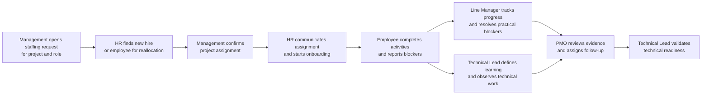
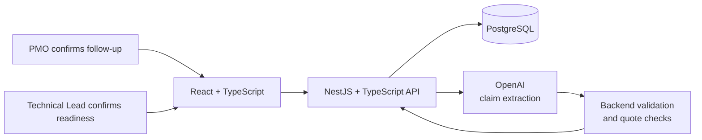

# ENGage Development Log

This document explains the intended workflow, target architecture, and verified build history for a teammate joining the project. It is based on the repository code, fictional sample data, and Git history. No official hackathon brief file is present in the repository, so the business and architecture descriptions below follow the requirements supplied to the team.

[Back to the project README](../README.md)

## 1. Business workflow

Management first opens a staffing request for a role on a project. HR identifies either a new hire or an existing employee who can be reallocated. Management confirms the assignment, then HR communicates it and helps start onboarding.

During onboarding, the employee completes activities and reports blockers. The Line Manager follows team progress and helps remove practical blockers. The PMO Coordinator reviews the available evidence, identifies gaps, and assigns follow-up tasks. The Technical Lead defines technical learning activities and validates readiness from evidence of observed work, rather than from an unsupported status alone.

The core records connect as follows:

- A **staffing request** belongs to a project and describes the role to fill.
- An **assignment** links an employee to that project.
- An **onboarding case** tracks the beginning of the assignment as either **New Hire** or **Reallocation**.

The first demo does not implement the earlier staffing screens. It begins with Eva Stone's existing onboarding case (`ONB-005`) in the PMO view for Project Orion.

## 2. Technical architecture

The target React frontend calls the NestJS API. NestJS stores application data and PMO-confirmed follow-up tasks in PostgreSQL and sends fictional onboarding evidence to OpenAI only when the PMO Coordinator requests analysis. The backend uses structured output, validates the response, confirms that every cited source belongs to the case, and checks every quote against the supplied source text before returning analysis. PMO can confirm a technical-review task independently of OpenAI; PostgreSQL prevents duplicate open technical reviews for the same case. The result is a suggestion for PMO review, while the Technical Lead confirms final technical readiness. The OpenAI API key remains on the server and is never exposed to the browser.

Docker Compose is planned to start the frontend, API, and PostgreSQL services together on a developer's machine, with service configuration supplied through environment variables. The repository now contains the React frontend, NestJS API, and PostgreSQL health check, but it does not yet contain a Compose file. No deployment provider or public URL could be verified from the repository.

## 3. Development history

The commit history gives a clear order for the work currently present: the Streamlit case page was committed first, an encoding-safe label update followed, and the evidence/review feature was committed next.

### 1. Streamlit PMO case page

- **Status:** Implemented
- **What changed:** Added a small Streamlit page for Eva Stone, Project Orion, case `ONB-005`, with the tracker-reported status **Ready with Support**. A later commit made the check mark and middle-dot labels encoding-safe.
- **Why it matters:** Establishes the first PMO demo view and keeps the tracker status distinct from final technical validation.
- **Relevant files:** `app.py`, `README.md`
- **How to verify:** Run `py -m streamlit run app.py` from the repository root and confirm the case identity and reported status. This entry is verified from code and Git history; it was not run in the documentation environment because neither `py` nor `python` was available there.

### 2. Source evidence and technical review note

- **Status:** Implemented
- **What changed:** Added two fictional emails dated 2026-10-13. The Technical Lead reports that two complex scenarios remain and classifies Eva as Ready with Support. The Line Manager reports that local onboarding is complete. The UI shows both original reports without forcing them into a single conclusion, plus a fixed evidence-gap note, missing-final-confirmation note, and suggested observation task.
- **Why it matters:** Lets the PMO Coordinator compare evidence, preserve potentially different scopes of assessment, and see what must be verified next.
- **Relevant files:** `app.py`, `data/evidence.json`
- **How to verify:** Start Streamlit, open both evidence expanders, and confirm Email 3, Email 4, their roles and dates, the original text, and the **Technical review needed** section. The JSON and rendering logic are verified from code; interactive expander behavior was not runtime-tested in the documentation environment.

### 3. Project documentation

- **Status:** Implemented
- **What changed:** Replaced the initial short README and added this workflow, architecture, and history document.
- **Why it matters:** Gives new teammates an accurate starting point and separates the working Streamlit prototype from the planned production stack.
- **Relevant files:** `README.md`, `docs/DEVELOPMENT_LOG.md`
- **How to verify:** Open both Markdown files, follow the relative links in each direction, and compare the run commands with the current `app.py` import and repository files.

### 4. Step 2 — React, NestJS, and PostgreSQL foundation

- **Status:** Implemented
- **What changed:** Added a Vite React/TypeScript frontend with loading, connected, and unavailable states. Added a NestJS/TypeScript backend with `GET /health`. The endpoint uses `DATABASE_URL` server-side and runs `SELECT 1`, returning HTTP 200 when PostgreSQL is reachable or HTTP 503 when it is unavailable. Added placeholder environment examples, npm manifests, lockfiles, and generated-file exclusions.
- **Why it matters:** Establishes the target frontend-to-API-to-database path before onboarding data, AI analysis, or task workflows are added.
- **Relevant files:** `frontend/package.json`, `frontend/package-lock.json`, `frontend/src/App.tsx`, `frontend/src/styles.css`, `frontend/.env.example`, `backend/package.json`, `backend/package-lock.json`, `backend/src/main.ts`, `backend/src/health.controller.ts`, `backend/src/database.service.ts`, `backend/.env.example`, `.gitignore`, `README.md`.
- **How to verify:** Run the install and start commands in `README.md`, then open `http://localhost:5173`. Both production builds were run successfully in the implementation environment. The compiled API was also started without `DATABASE_URL`; `GET /health` returned HTTP 503 and `{"status":"unavailable","api":"reachable","database":"unavailable"}`. PostgreSQL and Docker were not installed there, so HTTP 200 and the React connected state still require verification on a machine with PostgreSQL.

### 5. Step 3 - PostgreSQL-backed PMO case view

- **Status:** Implemented
- **What changed:** Added a root Python requirements file for the legacy Streamlit app. Added reproducible PostgreSQL schema and idempotent seed commands for Eva Stone's `ONB-005` case and its two evidence records. Added `GET /onboarding/cases/:caseId` with parameterized queries, a safe database-error response, and a 404 response for missing cases. Replaced the React health-only screen with a PMO case page that fetches the API record, displays both source emails in expandable sections, separates the reported tracker status from final technical readiness, and handles loading, unavailable, and not-found states.
- **Why it matters:** Moves the first fictional onboarding case into the target data flow: PostgreSQL stores the record, NestJS retrieves it, and React presents the evidence needed for PMO review without adding AI conclusions or task assignment prematurely.
- **Relevant files:** `requirements.txt`, `backend/db/schema.sql`, `backend/db/seed.sql`, `backend/scripts/run-sql.js`, `backend/package.json`, `backend/src/database.service.ts`, `backend/src/onboarding.controller.ts`, `backend/src/onboarding.service.ts`, `backend/src/app.module.ts`, `frontend/src/App.tsx`, `frontend/src/styles.css`, `README.md`, `docs/DEVELOPMENT_LOG.md`.
- **How to verify:** Follow the database setup, double-seed, and start commands in `README.md`. Confirm `/health` returns HTTP 200, `/onboarding/cases/ONB-005` returns one case with two evidence items, and an unknown ID returns HTTP 404. In React, confirm the Eva Stone header, Project Orion, reported status, Email 3, Email 4, and technical review note. Both production builds passed in the implementation environment. PostgreSQL was unavailable there, so schema execution, double-seed counts, live 200/404 responses, and browser rendering against real data remain pending.

### 6. Step 4 - On-demand OpenAI evidence analysis

- **Status:** Implemented
- **What changed:** Added `POST /onboarding/cases/:caseId/analyze`, the official OpenAI Node SDK, and a Zod structured-output schema. The backend reloads the case evidence from PostgreSQL, sends only the fictional case evidence to OpenAI, treats email content as untrusted source material, and validates the returned source IDs and exact quotes before returning the result. The React case page now starts analysis only when PMO clicks **Analyze evidence**, disables the button while pending, shows source-linked findings, an evidence gap, and a suggested next action, and keeps original evidence visible on failure.
- **Why it matters:** Gives the PMO Coordinator a traceable evidence summary without treating model output as final readiness or allowing it to change the tracker status. The Technical Lead remains the readiness owner.
- **Relevant files:** `backend/.env.example`, `backend/package.json`, `backend/package-lock.json`, `backend/src/analysis.model.ts`, `backend/src/analysis.schema.ts`, `backend/src/analysis.service.ts`, `backend/src/openai-analysis.model.ts`, `backend/src/onboarding.controller.ts`, `backend/src/app.module.ts`, `backend/test/analysis.service.test.js`, `frontend/src/App.tsx`, `frontend/src/styles.css`, `README.md`, `docs/DEVELOPMENT_LOG.md`.
- **How to verify:** Build both applications, then run `npm.cmd run test:analysis --prefix backend`. The mocked checks accept valid citations and reject both an unknown source ID and a quote missing from its source; all three checks passed in the implementation environment. PostgreSQL, Docker, `OPENAI_API_KEY`, and `OPENAI_MODEL` were unavailable there, so the live POST endpoint and browser analysis flow remain pending.

### 7. Step 5 - Persistent technical-review assignment

- **Status:** Implemented
- **What changed:** Added a `follow_up_tasks` PostgreSQL table linked to onboarding cases and a partial unique index that permits at most one open technical review per case. Added GET and POST follow-up endpoints with case and description validation, parameterized queries, safe database errors, and conflict handling that returns the existing open task without overwriting its description. The React case page now loads saved tasks on open, offers an editable manual description, prefills it from an AI suggestion when available, disables assignment while saving, and displays the persisted Technical Lead task with **Open** status.
- **Why it matters:** Lets PMO turn reviewed evidence into an owned, durable action while keeping task creation separate from OpenAI, the reported tracker status, and the Technical Lead's final readiness decision.
- **Relevant files:** `backend/db/schema.sql`, `backend/package.json`, `backend/src/follow-up.service.ts`, `backend/src/onboarding.controller.ts`, `backend/src/app.module.ts`, `backend/test/follow-up.service.test.js`, `frontend/src/App.tsx`, `frontend/src/styles.css`, `README.md`, `docs/DEVELOPMENT_LOG.md`.
- **How to verify:** Apply the schema, open `ONB-005`, assign the technical review, submit it again, refresh React, and confirm one task remains with its original description, Technical Lead assignee, and **Open** status. Both production builds passed. The existing three analysis tests and two mocked follow-up tests passed. PostgreSQL and Docker were unavailable in the implementation environment, so live persistence, concurrent duplicate handling, API GET/POST, and browser refresh verification remain pending.

## 4. Target-stack build order

Add future milestones using the same Status / What changed / Why it matters / Relevant files / How to verify format used above.

### 1. Set up React, NestJS, and PostgreSQL

- **Status:** Implemented
- **What changed:** Added the React frontend, NestJS API, PostgreSQL connection through `DATABASE_URL`, and database-backed health endpoint. Full Docker Compose setup remains Step 6.
- **Why it matters:** Creates the target application foundation and persistent data layer.
- **Relevant files:** `frontend/`, `backend/`, `.gitignore`, `README.md`.
- **How to verify:** Follow the foundation commands in `README.md`; confirm HTTP 200 from `/health` and **Services connected** in React when PostgreSQL is running.

### 2. Load fictional data and display Eva's case through the API

- **Status:** Implemented
- **What changed:** Added the PostgreSQL schema and idempotent demo seed, the case API endpoint, and the React PMO case view. The original JSON remains available to the Streamlit prototype.
- **Why it matters:** Moves the verified demo case into the target stack without changing its meaning.
- **Relevant files:** `backend/db/`, `backend/scripts/run-sql.js`, `backend/src/onboarding.controller.ts`, `backend/src/onboarding.service.ts`, `frontend/src/App.tsx`; source reference: `data/evidence.json`.
- **How to verify:** Seed the database, request `ONB-005` from the API, and confirm the React view displays Eva Stone, Project Orion, the reported tracker status, and both source emails.

### 3. Add OpenAI evidence analysis

- **Status:** Implemented
- **What changed:** Added on-demand OpenAI structured analysis, backend schema and citation validation, safe error handling, mocked validation tests, and the React analysis workflow.
- **Why it matters:** Extracts evidence claims while keeping source attribution reviewable.
- **Relevant files:** `backend/src/analysis.*`, `backend/src/openai-analysis.model.ts`, `backend/test/analysis.service.test.js`, `frontend/src/App.tsx`, `frontend/src/styles.css`.
- **How to verify:** Run the mocked analysis tests, then use configured PostgreSQL and OpenAI credentials to analyze `ONB-005` from the React page and inspect every source label and quote.

### 4. Let PMO assign and save a technical review task

- **Status:** Implemented
- **What changed:** Added persistent follow-up storage, idempotent open-task creation, GET/POST endpoints, mocked service tests, and the React assignment and reload flow.
- **Why it matters:** Turns an identified evidence gap into owned, persistent follow-up work.
- **Relevant files:** `backend/db/schema.sql`, `backend/src/follow-up.service.ts`, `backend/src/onboarding.controller.ts`, `backend/test/follow-up.service.test.js`, `frontend/src/App.tsx`, `frontend/src/styles.css`.
- **How to verify:** Assign a review to the Technical Lead, submit it again, reload the case, and confirm one open task with the original description and ownership persists.

### 5. Step 6 - Run with Docker Compose and verify the deployed demo

- **Status:** Planned
- **What changed:** Not started; no Docker or deployment configuration is present.
- **Why it matters:** Makes the complete stack reproducible and gives the hackathon team a demoable environment.
- **Relevant files:** To be created.
- **How to verify:** Start all services with Docker Compose, run the end-to-end Eva case flow, and record the verified deployment provider and public URL here only after they work.

[Back to the project README](../README.md)
